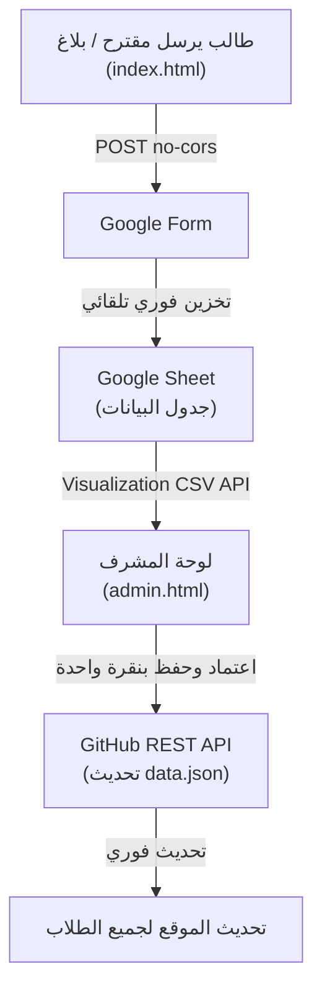

# 🎓 نافذة خدمية — اتحاد طلبة سوريا (فرع جامعة الأندلس)
> **دليل الطالب الخدمي والتفاعلي لطلاب جامعة الأندلس للعلوم الطبية في منطقة القدموس.**
> يتيح للطلاب وأعضاء الهيئة التدريسية الوصول الفوري والموثوق لأرقام الخدمات المحلية، صيدليات المناوبة اليومية، مواصلات المحافظات، وأرقام الطوارئ السريعة، مع دعم العمل الكامل دون اتصال بالإنترنت (PWA Offline).

---

## 🌟 أبرز المميزات

1. **💊 صيدلية اليوم المناوبة (تلقائية بالكامل):**
   - كاشف ذكي يعرض تلقائياً الصيدلية المناوبة ليوم اليوم في القدموس بناءً على التاريخ الحالي.
   - جدول متكامل لكامل الشهر (31 يوماً) مع بحث فوري ورابط مباشر للاتصال ومراسلة الصيدلية عبر واتساب.

2. **🏙️ خدمات منطقة القدموس الأساسية:**
   - **مطاعم ومعجنات:** أرقام الطلبات والتوصيل للسكنات.
   - **سوبر ماركت وبقالة:** أرقام التوصيل والمواد التموينية.
   - **صهاريج وتعبئة مياه:** تعبئة خزانات وبيدونات مياه الشرب النقية.
   - **حوالات مالية وشحن طرود:** مكاتب الهرم والفؤاد لشحن الحقائب والمستلزمات.
   - **مكتبات وطباعة وقرطاسية:** طباعة السلايدات والمحاضرات والبحوث الطبية.
   - **خدمات وصيانة سكنات:** صيانة سريعة للكهرباء والتمديدات الصحية والنت.
   - **حلويات وكافيه:** أرقام محلات وتواصي الحلويات.

3. **🚌 شركات النقل والمواصلات الخاصة:**
   - دليل منظم حسب المحافظة: (دمشق، حلب، حمص، حماة، اللاذقية، طرطوس، الحسكة / قامشلي، الرقة).
   - أرقام السائقين، روابط واتساب، ومواعيد السفر المعتادة.

4. **⚡ أزرار الاتصال والمراسلة الفورية:**
   - **اتصال بنقرة واحدة (`tel:`)** و **واتساب بنقرة واحدة (`wa.me`)** مع تنسيق الأرقام السورية تلقائياً (+963).
   - زر نسخ الرقم ومشاركة بطاقة الخدمة مع الزملاء.

5. **📱 تطبيق ويب تقدمي (PWA & Offline):**
   - إمكانية تثبيت الدليل كتطبيق رسمي على شاشة الهاتف الرئيسية (Android / iOS / PC).
   - تخزين ملفات الدليل بعد أول زيارة ناجحة (Service Worker `au-portal-v8`). التصفح متاح دون اتصال؛ الإرسال والنشر يتطلبان الإنترنت.

6. **⭐ تفاعل الطلاب (المفضلة، التقييم، الإبلاغ):**
   - **أرقامي المفضلة:** تثبيت الأرقام الأكثر استخداماً في أعلى الصفحة لسرعة الوصول.
   - **تقييم الخدمات:** نظام تقييم نزيه بالنجوم بدون تزييف مع منع التكرار العشوائي.
   - **إبلاغ عن رقم معطل:** إرسال بلاغ فوري عن أي رقم مقطوع لمراجعته.
   - **اقترح رقماً:** نموذج مبسط لمساهمة الطلاب في إثراء الدليل.

7. **🛡️ لوحة إدارة وتحكم للمشرف (`admin.html`):**
   - دخول آمن عبر GitHub Personal Access Token (لا تُخزن أي أسرار في الكود).
   - قراءة الردود والاقتراحات مباشرة من Google Sheets.
   - زر "اعتماد وإدراج" بنقرة واحدة مع النشر المباشر إلى مستودع GitHub عبر REST API.

---

## 📂 بنية المشروع (File Structure)

```text
au-service-portal/
├── index.html                 # واجهة الطلاب التفاعلية الكاملة
├── style.css                  # التصميم ونظام الألوان والمتغيرات والوضع الليلي
├── data.json                  # قاعدة بيانات الخدمات والمواصلات والصيدليات
├── admin.html                 # لوحة تحكم المشرف الموثقة مع GitHub
├── sw.js                      # مشغل وضع عدم الاتصال (Service Worker PWA)
├── manifest.json              # إعدادات تثبيت التطبيق على الهواتف
├── .gitignore                 # استبعاد الملفات الحساسة والسرية
├── shared.js                  # السمة والتخزين والتحقق من البيانات وإتاحة النوافذ
├── icon.svg                   # أيقونة الدليل المحلية
└── README.md                  # هذا الملف التوضيحي
```

---

## 🚀 التشغيل والنشر (Deployment)

### التشغيل المحلي:
شغّل خادماً محلياً لتحميل البيانات وتمكين التخزين دون اتصال (فتح الملف مباشرة يعرض البيانات الاحتياطية فقط):
```bash
# باستخدام Python:
python -m http.server 8000

# أو باستخدام Node.js:
npx serve .
```

### النشر على GitHub Pages:
1. ارفع ملفات المشروع إلى مستودع GitHub (سواء كان عاماً Public أو خاصاً Private).
2. ادخل إلى **Settings** > **Pages**.
3. تحت **Branch**، اختر `main` واضغط **Save**.
4. سيصبح موقعك متاحاً فوراً على:
   `https://<your-username>.github.io/<repo-name>/`

---

## 🔗 تدفق البيانات (Data Pipeline)



---

## 🤝 المساهمة والتواصل
هذا المشروع مبادرة تطوعية مخصصة لخدمة طلاب جامعة الأندلس للعلوم الطبية.
* **القناة الرسمية للفريق على تلغرام:** [@AU_Volunteer_Team](https://t.me/AU_Volunteer_Team)
* تم التطوير والتنظيم لصالح **اتحاد طلبة سوريا — فرع جامعة الأندلس**.
