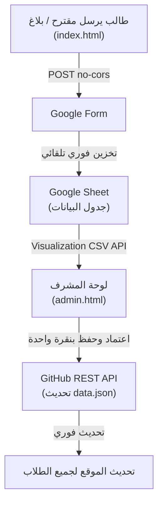

# 🎓 نافذة خدمية — اتحاد طلبة سوريا (فرع جامعة الأندلس)
> **دليل الطالب الخدمي والتفاعلي لطلاب جامعة الأندلس للعلوم الطبية في منطقة القدموس.**
> يتيح للطلاب وأعضاء الهيئة التدريسية الوصول الفوري والموثوق لأرقام الخدمات المحلية، صيدليات المناوبة اليومية، مواصلات المحافظات، وأرقام الطوارئ السريعة، مع دعم العمل الكامل دون اتصال بالإنترنت (PWA Offline).

---

## 🌟 أبرز المميزات

1. **💊 صيدلية اليوم المناوبة (تلقائية بالكامل):**
   - كاشف ذكي يعرض تلقائياً الصيدلية المناوبة ليوم اليوم في القدموس بناءً على التاريخ الحالي.
   - جدول متكامل لكامل الشهر (31 يوماً) مع بحث فوري ورابط مباشر للاتصال ومراسلة الصيدلية عبر واتساب.

2. **🏙️ خدمات منطقة القدموس الأساسية:**
   - **مطاعم ومعجنات:** أرقام الطلبات والتوصيل للسكنات.
   - **سوبر ماركت وبقالة:** أرقام التوصيل والمواد التموينية.
   - **صهاريج وتعبئة مياه:** تعبئة خزانات وبيدونات مياه الشرب النقية.
   - **حوالات مالية وشحن طرود:** مكاتب الهرم والفؤاد لشحن الحقائب والمستلزمات.
   - **مكتبات وطباعة وقرطاسية:** طباعة السلايدات والمحاضرات والبحوث الطبية.
   - **خدمات وصيانة سكنات:** صيانة سريعة للكهرباء والتمديدات الصحية والنت.
   - **حلويات وكافيه:** أرقام محلات وتواصي الحلويات.
   - **تكاسي وموتورات داخل القدموس:** نقل محلي مستقل عن مواصلات المحافظات؛ يظهر القسم عند إضافة أول رقم.
   - **ديليفري وتوصيل طلبات:** عمال توصيل الأكل والمشاوير داخل القدموس (نُقلت إدخالات الديليفري من قسم الصيانة إلى هنا).
   - **مكاتب الإيجار:** مكاتب إيجار الشقق والسكن في القدموس.

   في Google Form، أضف الخيارات التالية إلى سؤال **التصنيف** الحالي (`entry.880573565`): **تكاسي وموتورات داخل القدموس**، **ديليفري وتوصيل طلبات**، **صيدليات القدموس**، **مكاتب الإيجار**. تستخدم حقول الاسم والهاتف والملاحظات الحالية، ولا تتطلب محافظة أو أسئلة جديدة. يمكن ذكر نوع المركبة ومناطق الخدمة في الملاحظات.

3. **🚌 شركات النقل والمواصلات الخاصة:**
   - دليل منظم حسب المحافظة: (دمشق، حلب، حمص، حماة، اللاذقية، طرطوس، الحسكة / قامشلي، الرقة).
   - أرقام السائقين، روابط واتساب، ومواعيد السفر المعتادة.

4. **⚡ أزرار الاتصال والمراسلة الفورية:**
   - **اتصال بنقرة واحدة (`tel:`)** و **واتساب بنقرة واحدة (`wa.me`)** مع تنسيق الأرقام السورية تلقائياً (+963).
   - زر نسخ الرقم ومشاركة بطاقة الخدمة مع الزملاء.

5. **📱 تطبيق ويب تقدمي (PWA & Offline):**
   - إمكانية تثبيت الدليل كتطبيق رسمي على شاشة الهاتف الرئيسية (Android / iOS / PC).
   - تخزين ملفات الدليل بعد أول زيارة ناجحة (Service Worker `au-portal-v26`). التصفح متاح دون اتصال؛ الإرسال والنشر يتطلبان الإنترنت.

**التثبيت على Android:** زر التثبيت يستدعي المتصفح ولا يحمّل APK من المستودع. إذا حذّر Play Protect من استهداف إصدار Android قديم، حدّث Chrome وأعد المحاولة. الموقع لا يستطيع تعديل `targetSdkVersion` للحزمة التي ينشئها المتصفح. تتوفر إرشادات «تعذر التثبيت؟» لإنشاء اختصار إن عرضه المتصفح، أو حفظ إشارة مرجعية. قبول طلب التثبيت لا يُعرض كتأكيد على اكتماله.
الزر يختار المسار حسب الجهاز: Samsung Internet يعرض فتح Chrome مع خيار إضافي «التثبيت من المتصفح الحالي» إذا توفر طلب تثبيت أصلي، وiPhone/iPad يعرض خطوات Safari، والمتصفحات الداعمة تعرض نافذة التثبيت الأصلية. تظهر الإرشادات حتى دون حدث `beforeinstallprompt`، ويُخفى التنبيه عند تشغيل الدليل كتطبيق مستقل. تختلف إمكانات التثبيت باختلاف إصدار النظام والمتصفح، ولا يتجاوز أي زر حماية النظام.

### تصفح الأقسام
تظهر الأقسام كبطاقات مختصرة مع عدد الجهات. اختر قسماً لعرض جميع أرقامه، ثم «كل الأقسام» للعودة. البحث يشمل كل الدليل بغض النظر عن التبويب المختار؛ لا توجد قوائم مطوية أو أرقام مخفية خلف «عرض المزيد».
البطاقات مقسمة إلى **خدمات داخل القدموس** (ومنها التكاسي والموتورات المحلية) و**النقل خارج القدموس** حسب المحافظة. ترتيب السحب والإفلات يُطبّق داخل كل مجموعة.

### أدوات الإدارة والمتابعة
- لوحة المشرف مقسمة إلى **البيانات، إضافة جهة، الوارد، مراجعة التكرار، الترتيب والاستعادة**. افتح عنوان القسم ضمن البيانات لعرض أرقامه وتعديلها.
- **الترتيب:** من لوحة المشرف اسحب المقبض ⠿ لترتيب الأقسام، أو الأرقام داخل القسم نفسه. يعمل بالماوس واللمس، والأسهم بديل بلوحة المفاتيح. اضغط **حفظ ونشر**؛ يظهر الترتيب للطلاب عند اختيار الترتيب الافتراضي.
- **التحقق:** استخدم «تحققت اليوم» بعد التأكد فعلياً من الرقم، أو أدخل التاريخ في نافذة التعديل. يظهر تاريخ آخر تحقق بجانب بيانات الجهة، وزر «الرقم لا يعمل؟» يفتح البلاغ.
- **الديليفري:** حقول لمناطق التوصيل والأجرة ونوع الطلبات في الإضافة والتعديل واقتراحات الطلاب. ساعات العمل تُدخل من حقول الدوام الحالية. في Google Form أضف خيار **ديليفري وتوصيل طلبات** إلى سؤال التصنيف الحالي؛ لا حاجة لأسئلة جديدة.
- **التكرار:** تعديل أي إدخال، دمج الإدخالات الخاطئة في الجهة الأولى، أو تأكيد الخدمة المتعددة مع إمكانية إلغاء القرار. تأكيد التكرار مرتبط بالإدخالات الحالية؛ ظهور إدخال جديد بنفس الرقم يعيد المراجعة.
- **سلة المحذوفات:** تشمل الحذف العادي وحذف البلاغات والتكرارات. زر «استعادة» يعيد البيانات والقسم؛ استعادة إدخال مدموج تتراجع عن الدمج أيضاً إذا لم يُعدّل الهدف لاحقاً. كل ذلك يحتاج **حفظ ونشر**.
- **مشاركة الأقسام:** افتح القسم ثم «مشاركة القسم». الروابط تفتح القسم مباشرة وتعمل مع زر رجوع المتصفح.
- **متابعة الاقتراحات:** من الزر بجوار عنوان الموقع. الاقتراحات الجديدة تحصل على رقم متابعة محفوظ في الجهاز ويمكن نسخه لجهاز آخر. يُرسل الرمز داخل حقل الملاحظات الحالي، ويُنشر القبول/الرفض عند قرار المشرف؛ «إعادة للمراجعة» تعيد حالة الانتظار. Google Form لا يؤكد الاستلام عبر `no-cors`، لذلك تعرض الحالة ذلك بوضوح إلى أن يُنشر القرار. زر تحديث الحالات يجلب آخر القرارات المنشورة.

الحقول الجديدة اختيارية ومتوافقة مع البيانات القديمة: `category_order`, `trash`, `duplicate_reviews`, `suggestion_status` على مستوى الملف، و`last_verified` و`delivery: {areas, fee, kind}` على مستوى الجهة. لا تُختلق تواريخ تحقق للبيانات القديمة.

### سعر الصرف (دولار → ليرة)
- يظهر سعر الدولار (شراء/مبيع، دمشق) فوق أزرار حاسبة الفواتير، مع تنبيه بأن الأسعار من **الليرة اليوم (SP-Today)** ورابط لمراجعة الأسعار المحدثة للدقة.
- التحديث تلقائي: مهمة GitHub Actions (`.github/workflows/update-rates.yml`) تجلب السعر كل ساعة عبر `scripts/update-rates.py` (منطق الـscraping من `sp-today.py` — دمشق فقط، بدون تخمين) وتنشر `rates.json` عند تغيّره فقط. لا مفاتيح سرية ولا ERP في الموقع العام.
- الموقع يقرأ `rates.json` مباشرة (يتجاوز كاش GitHub Pages)، ويحتفظ بآخر سعر صالح على الجهاز عند انقطاع الإنترنت، ويعلّم الأسعار القديمة (أكثر من 6 ساعات) بوضوح.

6. **⭐ تفاعل الطلاب (المفضلة، التقييم، الإبلاغ):**
   - **أرقامي المفضلة:** تثبيت الأرقام الأكثر استخداماً في أعلى الصفحة لسرعة الوصول.
   - **تقييم الخدمات:** تقييم محفوظ لكل خدمة على جهازك، قابل للتعديل بالضغط على نجمة أخرى. تُرسل التعديلات مع ملاحظة توضح التقييم السابق والجديد.
   - **إبلاغ عن رقم معطل:** إرسال بلاغ فوري عن أي رقم مقطوع لمراجعته.
   - **اقترح رقماً:** نموذج مبسط لمساهمة الطلاب في إثراء الدليل.

7. **🛡️ لوحة إدارة وتحكم للمشرف (`admin.html`):**
   - دخول آمن عبر GitHub Personal Access Token (لا تُخزن أي أسرار في الكود).
   - قراءة الردود والاقتراحات مباشرة من Google Sheets.
   - زر "اعتماد وإدراج" بنقرة واحدة مع النشر المباشر إلى مستودع GitHub عبر REST API.

---

## 📂 بنية المشروع (File Structure)

```text
au-service-portal/
├── index.html                 # واجهة الطلاب التفاعلية الكاملة
├── style.css                  # التصميم ونظام الألوان والمتغيرات والوضع الليلي
├── data.json                  # قاعدة بيانات الخدمات والمواصلات والصيدليات
├── admin.html                 # لوحة تحكم المشرف الموثقة مع GitHub
├── sw.js                      # مشغل وضع عدم الاتصال (Service Worker PWA)
├── manifest.json              # إعدادات تثبيت التطبيق على الهواتف
├── .gitignore                 # استبعاد الملفات الحساسة والسرية
├── shared.js                  # السمة والتخزين والتحقق من البيانات وإتاحة النوافذ
├── Asset 1.png                # أيقونة الشعار الأصلية
├── Vertical Trans.png         # الشعار العمودي الأصلي
├── Horiszontal.png            # صورة الفوتر الأصلية (اسم الملف كما هو على GitHub)
├── app-logo-192.png            # نسخة من الشعار الأصلي بقياس مناسب لتثبيت التطبيق
├── app-logo-512.png            # نسخة كبيرة من الشعار الأصلي لتثبيت التطبيق
└── README.md                  # هذا الملف التوضيحي
```

---

## 🚀 التشغيل والنشر (Deployment)

### التشغيل المحلي:
شغّل خادماً محلياً لتحميل البيانات وتمكين التخزين دون اتصال (فتح الملف مباشرة يعرض البيانات الاحتياطية فقط):
```bash
# باستخدام Python:
python -m http.server 8000

# أو باستخدام Node.js:
npx serve .
```

### النشر على GitHub Pages:
1. ارفع ملفات المشروع إلى مستودع GitHub (سواء كان عاماً Public أو خاصاً Private).
2. ادخل إلى **Settings** > **Pages**.
3. تحت **Branch**، اختر `main` واضغط **Save**.
4. سيصبح موقعك متاحاً فوراً على:
   `https://<your-username>.github.io/<repo-name>/`

---

## 🔗 تدفق البيانات (Data Pipeline)

### تنسيق أرقام الهاتف
- تُوحّد الأرقام السورية المحلية والدولية (`+963` و`00963`)، والمسافات والشرطات والأرقام العربية.
- يمكن إدخال رقمين أو أكثر في الحقل نفسه: `0995787906 0990351968`، وتُحفظ بصيغة `0995787906 / 0990351968` مع زر اتصال وواتساب مستقل لكل رقم محمول.
- لا يلزم إضافة حقل في Google Form؛ اجعل سؤال الهاتف **إجابة قصيرة** دون شرط «رقم فقط» ليقبل الأرقام المتعددة والروابط.
- تبقى القيم الناقصة أو غير الواضحة للمراجعة، ولا تتحول إلى روابط اتصال مدمجة.



---

## 🤝 المساهمة والتواصل
هذا المشروع مبادرة تطوعية مخصصة لخدمة طلاب جامعة الأندلس للعلوم الطبية.
* **القناة الرسمية للفريق على تلغرام:** [@studentandalus](https://t.me/studentandalus)
* تم التطوير والتنظيم لصالح **اتحاد طلبة سوريا — فرع جامعة الأندلس**.
